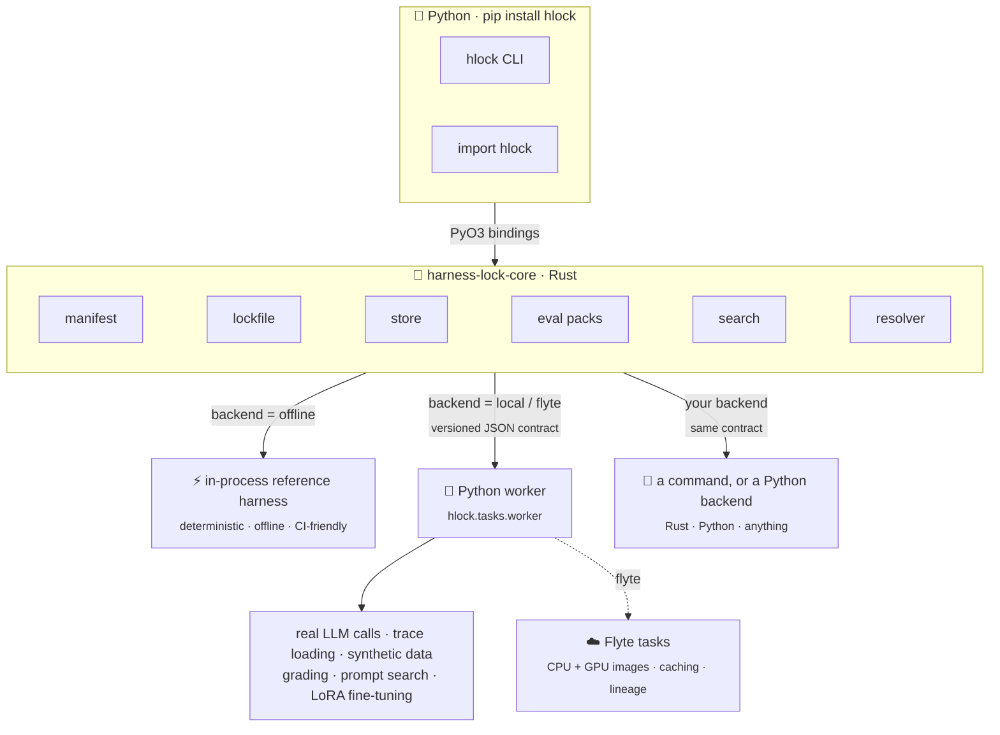

# Architecture

`hlock` splits its work by what each part needs. Everything deterministic lives in a
Rust core. Anything that needs the Python ML ecosystem or a GPU runs on a backend: hlock's
Python worker on this machine, Flyte tasks on a cluster, or a backend you write.



## The Rust core

[`harness-lock-core`](https://docs.rs/harness-lock-core) is pure Rust with no Python
dependency. It owns:

- **manifest**: parsing and hashing `harness.toml`
- **lockfile**: the schema-v1 `harness.lock` and `harness.tune.lock` models
- **store**: a content-addressed store for trial artifacts under `.hlock/`
- **eval packs**: loading packs, the deterministic search/holdout split, and grading
- **search**: grid expansion, Pareto fronts, constraint filtering, winner selection
- **resolver**: running trials, aggregating evidence, and building the lock
- **meta**: the [meta harness](../guides/meta.md): choosing and configuring it, rendering
  job prompts, and verifying their results

The core orchestrates and aggregates. It never does heavy compute itself.

## The Python layer

The `hlock` package is a thin layer over the core:

- **PyO3 bindings** (`hlock._hlock`), compiled into the wheel, expose
  `Manifest`, `SearchSpace`, `resolve`, `load`, and the rest of the
  [Python API](../reference/python-api.md).
- **The CLI** (`hlock.cli`) is built on those bindings, so the CLI and the API
  always behave the same.
- **The worker** (`hlock.tasks.worker`) runs the heavy stages, for every Python backend.
- **Backends** (`hlock.backends`) decide where the worker runs each stage: `local`
  in process, `flyte` as Flyte tasks, or a third-party backend.

## The backend contract

On every backend but `offline`, the Rust core sends each work item to a backend
process. For Python backends (`local`, `flyte`, and any registered in
`hlock.backends`), that's hlock's worker:

```bash
$HL_PYTHON -m hlock.tasks.worker request.json response.json
```

A command backend (`[backends.<name>] command`, or `hlock-backend-<name>` on `PATH`) is
run the same way, as `<command…> request.json response.json`. Requests and responses
follow a versioned JSON contract (`CONTRACT_VERSION = 4`). The core only ever sees the
response, so it doesn't depend on where the work ran: in process, on this machine, or
as a Flyte task on a GPU node.

| Request field | Meaning |
|---|---|
| `version` | The contract version (4). A backend refuses one it doesn't know |
| `kind` | `backend.describe`, `llm.run_trial`, `data.load`, `data.synthetic`, `grade`, `harness.optimize`, `prompt.search` (the old prompt stage), or `ft.lora` |
| `backend` | The backend's name |
| `backend_options` | `[backends.<name>] options`, or `{}` |
| `backend_object` | `[backends.<name>] python`, when set: the `module:attr` the worker loads |
| `stack`, `task`, `seed` | The trial's configuration, task, and seed (empty for stages) |
| `workdir` | A directory the item works in. A trial's holds the task's fixtures, and hlock grades what's left there |
| `plan` | The tune plan: depth, data source, axes |
| `optimize` | `harness.optimize` only: the bundle, the session, the splits, the budget (see [Write an optimizer](../guides/backends.md#write-an-optimizer)) |

A trial's `stack` has `system_prompt` when tune runs it with a candidate's (or the lock's)
instruction files: a single-completion trial sends it as the system message.

The response is `{"version": 4, "ok": true, "result": {...}}`, or
`{"version": 4, "ok": false, "error": "..."}` with a non-zero exit. A result has
`success`, `score`, `cost_usd` (`null` when unknown), `simulated`, `gpu_h`,
`latency_s`, `steps`, `trace`, `artifact_digests`, and `model_digests` (stage metadata;
a `run` key there is recorded as the run in the tune lock); `harness.optimize`'s also has
`candidate`, `ledger`, `optimizer` and `usage`. Every field is optional.

`backend.describe` comes first, and its result says what the backend runs: `name`,
`kinds`, `model_endpoint` (its trials call `HL_LLM_BASE_URL`), and `about`. A stage the
backend doesn't list is skipped. See [Write your own backend](../guides/backends.md#write-your-own-backend).

Each stock handler owns one stage of [`hlock tune`](../guides/tune.md):
LLM trials, trace loading, synthetic data, grading, the built-in optimizer, and LoRA
fine-tuning. The `flyte` backend runs each one inside a Flyte 2 task: a CPU
environment for data, prompt, and LLM trials, a GPU environment for fine-tuning, and
`cache="auto"` so re-runs reuse finished items.

The heavy libraries are optional. Without them, the worker falls back to a
deterministic offline LLM and reports which capabilities are unavailable, so it stays
runnable in CI and on a bare install.

## Repository layout

| Path | Contents |
|---|---|
| `crates/harness-lock-core` | The Rust core library |
| `crates/harness-lock-py` | PyO3 bindings, shipped only inside the wheel (`publish = false`) |
| `crates/hlock`, `crates/harness-lock` | Thin crates that re-export the core (`harness-lock` is the alias) |
| `hlock/` | The Python package: bindings re-export, CLI, worker |
| `harness_lock/` | Shim that re-exports `hlock`, so `import harness_lock` works |
| `packaging/harness-lock` | The `harness-lock` PyPI alias, pinned to the matching `hlock` |
| `evals/` | The demo eval pack |
| `docs/` | This site |
| `specs/` | The design specs, including what's still on the roadmap |
