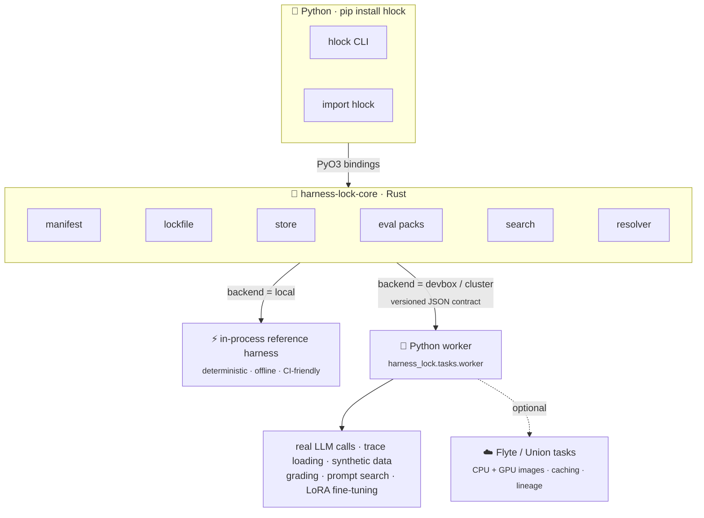

# Architecture

`hlock` splits its work by what each part needs. Everything deterministic lives in a
Rust core. Anything that needs the Python ML ecosystem or a GPU runs in a Python worker,
which can lift each piece of work to a Flyte task on a cluster.



## The Rust core

[`harness-lock-core`](https://docs.rs/harness-lock-core) is pure Rust with no Python
dependency. It owns:

- **manifest**: parsing and hashing `harness.toml`
- **lockfile**: the schema-v1 `harness.lock` and `harness.tune.lock` models
- **store**: a content-addressed store for trial artifacts under `.harnesslock/`
- **eval packs**: loading packs, the deterministic search/holdout split, and grading
- **search**: grid expansion, Pareto fronts, constraint filtering, winner selection
- **resolver**: running trials, aggregating evidence, and building the lock
- **meta**: the [meta harness](../guides/meta.md): choosing and configuring it, rendering
  job prompts, and verifying their results

The core orchestrates and aggregates. It never does heavy compute itself.

## The Python layer

The `hlock` package is a thin layer over the core:

- **PyO3 bindings** (`harness_lock._harness_lock`), compiled into the wheel, expose
  `Manifest`, `SearchSpace`, `resolve`, `load`, and the rest of the
  [Python API](../reference/python-api.md).
- **The CLI** (`harness_lock.cli`) is built on those bindings, so the CLI and the API
  always behave the same.
- **The worker** (`harness_lock.tasks.worker`) runs the heavy stages.

## The worker contract

On the `devbox` and `cluster` backends, the Rust core shells each work item out to:

```bash
$HL_PYTHON -m harness_lock.tasks.worker request.json response.json
```

Requests and responses follow a versioned JSON contract (`CONTRACT_VERSION = 1`). The
core only ever sees the response, so it doesn't depend on where the work ran: in
process, on this machine, or as a Flyte task on a GPU node.

Each worker handler owns one stage of [`hlock tune`](../guides/tune.md):
LLM trials, trace loading, synthetic data, grading, prompt search, and LoRA
fine-tuning. On `cluster`, the worker lifts each body to a Flyte 2 task: CPU images
for data, prompt, grading, and LLM trials; a GPU image with an accelerator request for
fine-tuning; `cache="auto"` for durable trial caching; and dataset and adapter
offloading through `flyte.io`.

The heavy libraries are optional. Without them, the worker falls back to a
deterministic offline LLM and reports which capabilities are unavailable, so it stays
runnable in CI and on a bare install.

## Repository layout

| Path | Contents |
|---|---|
| `crates/harness-lock-core` | The Rust core library |
| `crates/harness-lock-py` | PyO3 bindings, shipped only inside the wheel (`publish = false`) |
| `crates/hlock`, `crates/harness-lock` | Thin crates that re-export the core (`harness-lock` is the alias) |
| `harness_lock/` | The Python package: bindings re-export, CLI, worker |
| `hlock/` | Shim that re-exports `harness_lock`, so `import hlock` works |
| `packaging/harness-lock` | The `harness-lock` PyPI alias, pinned to the matching `hlock` |
| `evals/` | The demo eval pack |
| `docs/` | This site |
| `specs/` | The design specs, including what's still on the roadmap |
