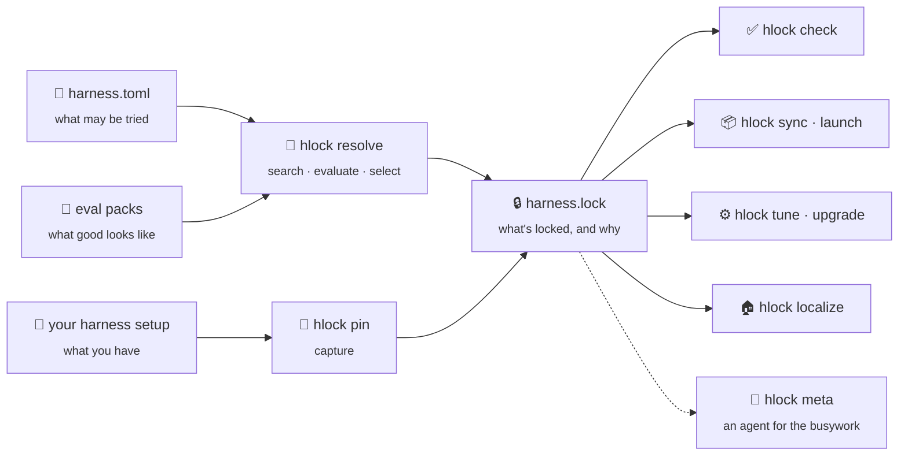

# How it works

An agent is more than a model. It's a harness at some version, one or more models, MCP
servers, skills, plugins, instruction files, and config, plus, for tuned agents, a
decision model that routes between options and policies like retries and step limits.
Change any one of these and the agent behaves differently.

`hlock` treats that combination, the **stack**, the way a package manager treats
dependencies: a lockfile pins every part of it, and the same lock brings the same agent
back anywhere. There are two ways to get a lock:

- **Pin** the setup you already have. `hlock pin` reads your harness's config and records
  what's there. No manifest, no tasks.
- **Resolve** a better one. You declare what may be tried in `harness.toml`, and
  `hlock resolve` measures every combination against your tasks and locks the winner.

## Pinning

[`hlock pin`](../guides/pin.md) finds the harness you use, reads it through its
[profile](../guides/harness-profiles.md), and writes everything into the lock with a
digest: the harness version and install source, models and the local runtimes serving
them, MCP servers, skills, plugins, instruction files, and config. Secrets become
`HLOCK_SECRET_*` placeholders, and anything another machine can't download is vendored
into `.hlock/vendor/`.

On a pinned lock, `hlock check` re-captures the setup and reports what changed, and
re-pinning records the change. [`hlock sync`](../guides/sync.md) turns the lock back into
a working setup on another machine, and [`hlock launch`](../guides/launch.md) starts the
harness in an isolated environment built from it.

## The manifest

Resolving starts from [`harness.toml`](../reference/manifest.md), the part you write. It has four jobs:

- **Candidates:** the models (per role), decision models, and harnesses the resolver may
  combine.
- **Evals:** which [eval packs](../guides/eval-packs.md) to measure against, and how
  many times to run each one.
- **Objective:** the metric that matters, hard constraints, and a rule for choosing
  among the stacks that pass.
- **Budget and backend:** how much searching to do, and where the trials run.

## The resolver

`hlock resolve` expands the candidates into a grid of concrete stacks: every planner
model × every decision model × every harness. It then runs each stack on every task in
the pack's *search split*, once per seed, and grades the result.

Each trial records whether the task succeeded, what it cost, and how long it took. Per
stack, those roll up into a success rate, a mean cost per task, and latency
percentiles.

### Selection

Picking the winner happens in three steps:

1. **Pareto front.** Drop every stack that another stack beats on both success rate
   and cost. What's left is the set of stacks that are each the best trade-off at
   some price point.
2. **Constraints.** Keep the stacks on the front that satisfy `[objective.constraints]`,
   such as `success-rate = ">=0.8"`. If none do, `hlock` falls back to the whole front
   rather than failing, so check the evidence in the lock.
3. **Select rule.** `select = "min-cost"` takes the cheapest remaining stack.
   `select = "max-quality"` takes the one with the highest success rate.

## The lockfile

A resolved [`harness.lock`](../reference/lockfile.md) records the outcome:

- the exact **stack**: each model by role and provider, with a fingerprint; the
  decision model; the harness; the policy (retries, step limits, sandbox, approvals);
- the **evidence**: trials, success rate, cost, and latency on the eval pack;
- **provenance**: the backend that produced it and the search settings;
- the **manifest hash**, which ties the lock to the exact `harness.toml` it came from.

The lock is plain TOML, generated, and meant to be committed. Reviewing a lock diff in
a PR tells you what changed in the agent and what evidence supports the change.

## What you do with a lock

| Command | What it does |
|---|---|
| [`hlock check`](../guides/pin.md#keep-it-honest-with-check) | On a pinned lock, fails if your setup changed. On a resolved lock, fails if `harness.toml` changed after the lock was written; put it in [CI](../guides/ci.md). |
| [`hlock sync`](../guides/sync.md) | Rehydrates the locked setup on this machine, in a directory, or in a Docker image. |
| [`hlock launch`](../guides/launch.md) | Starts the harness on the locked setup, isolated from your own config. |
| [`hlock run`](../reference/cli.md#run) | Runs the locked stack on a prompt. |
| [`hlock upgrade`](../guides/upgrade.md) | On a resolved lock, finds newer models for locked roles, re-measures, and applies only on request, keeping the old lock for rollback. |
| [`hlock tune`](../guides/tune.md) | Goes beyond choosing: tunes prompts and hyperparameters, and can fine-tune small models, writing `harness.tune.lock`. |
| [`hlock localize`](../guides/localize.md) | Writes an equivalent lock that runs entirely on your machine. |
| [`hlock meta`](../guides/meta.md) | Hands work that needs judgment (installs, filling in eval packs, updates) to a pinned agent (built into hlock, or an open-source harness), and checks the result. |

## The meta harness

Some of the work around a lock needs judgment: installing a harness at its pinned version
on a machine hlock has never seen, turning a repository's history into eval tasks,
updating a dozen skills and MCP servers. That's a job for an agent, not for
deterministic code. [`hlock meta`](../guides/meta.md) gives hlock an agent of its own for
it, the **meta harness**: by default an agent built into hlock, running on your API key
or a local model.

The meta harness gets the same treatment as your agent. It's configured in
`harness.meta.toml`, pinned in `harness.meta.lock`, and checked with `hlock meta check`.
Each job splits the work the same way:

- hlock decides what's needed (a sync plan, an eval pack's format, the lock's skills) and
  writes the prompt;
- the agent works out how to do it on this machine, within the commands you allow;
- hlock checks the result itself (re-plans the sync, loads the pack, re-captures the
  harness) and exits non-zero if the job isn't done.

The agent never decides whether it succeeded.

## Search and holdout splits

An eval pack is split deterministically into a **search** split, used to pick the
winner, and a **holdout** split, used to confirm the gain is real. The split defaults
to 70/30 by task id, seeded by `[budget] random_seed`, so the same manifest always
produces the same split. Deep `hlock tune` runs (`--depth full`) re-validate on
the holdout split.
