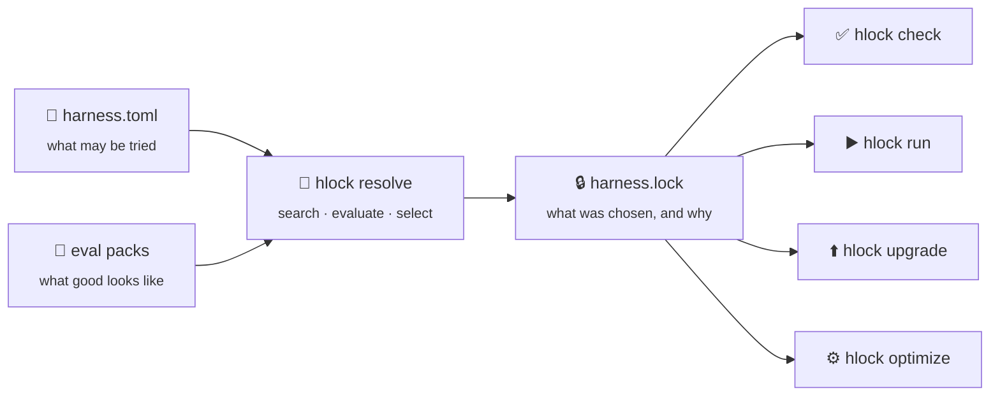

# How it works

An agent is more than a model. It's a model (or several), a harness that drives it,
maybe a decision model that routes between options, and policies like retries and step
limits. Changing any one of these changes how well the agent does your work.

`hlock` treats that combination, the **stack**, the way a package manager treats
dependencies: you declare what's allowed, a resolver picks a concrete set, and a
lockfile pins it.

## The manifest

[`harness.toml`](../reference/manifest.md) is the part you write. It has four jobs:

- **Candidates:** the models (per role), decision models, and harnesses the resolver may
  combine.
- **Evals:** which [eval packs](../guides/eval-packs.md) to measure against, and how
  many times to run each one.
- **Objective:** the metric that matters, hard constraints, and a rule for choosing
  among the stacks that pass.
- **Budget and backend:** how much searching to do, and where the trials run.

## The resolver

`hlock resolve` expands the candidates into a grid of concrete stacks: every planner
model × every decision model × every harness. It then runs each stack on every task in
the pack's *search split*, once per seed, and grades the result.

Each trial records whether the task succeeded, what it cost, and how long it took. Per
stack, those roll up into a success rate, a mean cost per task, and latency
percentiles.

### Selection

Picking the winner happens in three steps:

1. **Pareto front.** Drop every stack that another stack beats on both success rate
   and cost. What's left is the set of stacks that are each the best trade-off at
   some price point.
2. **Constraints.** Keep the stacks on the front that satisfy `[objective.constraints]`,
   such as `success-rate = ">=0.8"`. If none do, `hlock` falls back to the whole front
   rather than failing, so check the evidence in the lock.
3. **Select rule.** `select = "min-cost"` takes the cheapest remaining stack.
   `select = "max-quality"` takes the one with the highest success rate.

## The lockfile

[`harness.lock`](../reference/lockfile.md) records the outcome:

- the exact **stack**: each model by role and provider, with a fingerprint; the
  decision model; the harness; the policy (retries, step limits, sandbox, approvals);
- the **evidence**: trials, success rate, cost, and latency on the eval pack;
- **provenance**: the backend that produced it and the search settings;
- the **manifest hash**, which ties the lock to the exact `harness.toml` it came from.

The lock is plain TOML, generated, and meant to be committed. Reviewing a lock diff in
a PR tells you what changed in the agent and what evidence supports the change.

## What you do with a lock

| Command | What it does |
|---|---|
| [`hlock check`](../guides/ci.md) | Fails if `harness.toml` changed after the lock was written. Put it in CI. |
| [`hlock run`](../reference/cli.md#run) | Runs the pinned stack on a prompt. |
| [`hlock upgrade`](../guides/upgrade.md) | Finds newer models for locked roles, re-measures, and applies only on request, keeping the old lock for rollback. |
| [`hlock optimize`](../guides/optimize.md) | Goes beyond choosing: tunes prompts and hyperparameters, and can fine-tune small models, writing `harness.opt.lock`. |

## Search and holdout splits

An eval pack is split deterministically into a **search** split, used to pick the
winner, and a **holdout** split, used to confirm the gain is real. The split defaults
to 70/30 by task id, seeded by `[budget] random_seed`, so the same manifest always
produces the same split. Deep `hlock optimize` runs (`--depth full`) re-validate on
the holdout split.
