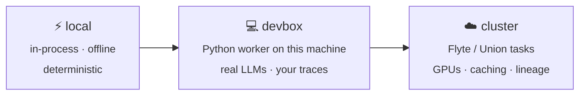

# Backends

The backend decides where trials run. It's a dial: start on `local`, and move to
`devbox` or `cluster` when you need real models, your own data, or GPUs. The manifest,
the lockfile, and the commands are the same on every backend.



| Backend | Where trials run | Use it for |
|---|---|---|
| `local` *(default)* | In process, on the Rust reference harness | Trying `hlock` out, CI, deterministic tests |
| `devbox` | A Python worker on this machine | Real LLM calls, loading your traces, `flyte local` |
| `cluster` | A Python worker that lifts each stage to a Flyte/Union task | GPUs for fine-tuning, fan-out, durable caching, team-shared results |

## Choosing a backend

Set a default in the manifest:

```toml title="harness.toml"
[backend]
target = "devbox"
```

Override it for one command with `--backend`:

```bash
hlock resolve --backend local
hlock tune --backend cluster --depth ft
```

Check what's configured with `hlock backend status`:

```console
$ hlock backend status
backend          local  (from harness.toml)
HL_PYTHON        python3 (default)
HL_LLM_BASE_URL  unset: offline reference LLM
flyte config     ~/.flyte/config.yaml
```

## `local`

Everything runs in process on the deterministic reference provider and harness. It
needs no setup, no network, and no keys, and the same manifest always produces the
same lock. Use it to learn `hlock`, to test manifests, and in CI.

## `devbox`

The Rust core hands each work item to the Python worker over a
[versioned JSON contract](../concepts/architecture.md#the-worker-contract). The worker
runs on this machine, in the interpreter named by `HL_PYTHON`.

1.  Point `HL_PYTHON` at an interpreter that has `hlock` installed:

    ```bash
    export HL_PYTHON="$(which python)"
    ```

2.  To call a real model, point the worker at any OpenAI-compatible endpoint, such as
    vLLM, SGLang, Ollama, or a hosted API:

    ```bash
    export HL_LLM_BASE_URL=http://localhost:8000/v1
    export HL_LLM_MODEL=qwen-32b     # what reference:… candidates ask for
    export HL_LLM_API_KEY=...        # if the endpoint needs one
    ```

    Each candidate asks the endpoint for its own model: `openai:gpt-5` requests
    `gpt-5`. `HL_LLM_MODEL` stands in only for `reference:…` candidates. Without
    `HL_LLM_BASE_URL`, `reference:…` candidates run on the deterministic offline
    reference, and any other candidate fails before it runs: "the devbox backend needs a
    model endpoint for openai:gpt-5: set HL_LLM_BASE_URL (see Backends)".

3.  Install the libraries for the stages you'll use:

    | Stage | Install |
    |---|---|
    | Loading traces (CSV, JSONL, Parquet) | `polars` or `pandas` |
    | LoRA fine-tuning (`--depth ft`) | `torch`, `peft`, `trl` |

4.  Run it:

    ```bash
    hlock tune --backend devbox --depth probe --max-trials 10
    ```

### What a `devbox` trial is

A trial on `devbox` is a single completion, not an agent loop. The trial's workspace
starts from the task's fixtures, as on every backend. The model gets the task's prompt and
the text of the files in its workspace (up to 20,000 characters), and its reply is written
to the task's first expected artifact, or `answer.md` when it has none. A code fence around
the whole reply is dropped. The task's [graders](eval-packs.md#grading) then decide
whether the trial passed, the same way they do on `local`.

That fits tasks whose answer is one file: a summary, a value, a reply, a cleaned file. A
task that needs tools, several files, or a running loop needs an agent. Run your own as a
[code harness](harnesses.md#your-own-agent-frameworks-and-custom-scripts), which runs
for real in trials on every backend.

A trial's cost is what the endpoint reports (`usage.cost`, as OpenRouter's does). When it
reports none, the cost is unknown: the trace records it as `null`, and it adds nothing to
the totals.

## `cluster`

Same worker, but it lifts each stage to a real [Flyte 2](https://www.union.ai/docs/flyte/)
task on a Flyte or Union cluster:

- CPU images for data loading, prompt search, grading, and LLM trials
- a GPU image with an accelerator request for LoRA fine-tuning
- `cache="auto"`, so re-runs reuse finished trials
- datasets and adapters offloaded through `flyte.io`
- run ids and budget recorded as provenance in the lock

Setup:

1.  Install the Flyte extra: `pip install "hlock[flyte]"`
2.  Configure access to your cluster in `~/.flyte/config.yaml`. With Union, run
    `flyte create config` and log in.
3.  Run it:

    ```bash
    hlock tune --backend cluster --depth ft --data user:./runs
    ```

If the Flyte SDK isn't importable, the worker runs each stage in process and reports
that it did, rather than failing.

Fine-tuning on a cluster can take a long time. Run it in the background with
`hlock tune --detach`; see [Running in the background](tune.md#running-in-the-background).

## Environment variables

See the [environment variable reference](../reference/environment.md) for every `HL_*`
variable and its default.
