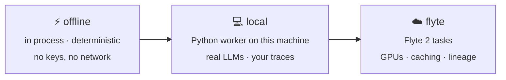

# Backends

The backend decides where trials and tune stages run. It's a dial: start on `offline`,
move to `local` when you need real models or your own data, and to `flyte` when you need
GPUs or a cluster. The manifest, the lockfile, and the commands are the same on every
backend, and you can [write your own](#write-your-own-backend).



| Backend | Where the work runs | Use it for |
|---|---|---|
| `offline` *(default)* | In process, on the Rust reference harness | Trying `hlock` out, CI, deterministic tests |
| `local` | hlock's Python worker, on this machine | Real LLM calls, loading your traces, LoRA on a local GPU |
| `flyte` | The same work, each item run as a Flyte 2 task on your cluster | GPUs for fine-tuning, durable caching, team-shared runs |
| *your own* | Wherever your backend sends it | Ray, Modal, Kubernetes Jobs, Slurm, an internal runner |

!!! note "Renamed backends"
    `local` used to be called `devbox`, `flyte` used to be `cluster`, and `offline` used to
    be `local`. The old names `devbox` and `cluster` still work for now and print a note.
    A manifest with `target = "local"` from before the rename now selects the Python
    worker; change it to `target = "offline"` to keep the in-process reference.

## Choosing a backend

Set a default in the manifest:

```toml title="harness.toml"
[backend]
target = "local"
```

Override it for one command with `--backend`:

```bash
hlock resolve --backend offline
hlock tune --backend flyte --depth ft
```

Check what's configured, how it was found, and what it runs with `hlock backend status`:

```console
$ hlock backend status
backend  offline  (from harness.toml)
found    built in, in process
runs     trials, in process on the reference harness
```

`hlock backend list` shows every backend you can select:

```console
$ hlock backend list
  backend    found
  offline    built in, in process
  local      built in, Python worker
  flyte      built in, Python worker
  logged     harness.toml: Python object my_backend:LoggedBackend
  echo       hlock-backend-echo on PATH
```

Before any work runs, hlock asks the backend what it runs. A tune stage the backend
doesn't run is skipped and says why, and a backend that doesn't run trials stops `resolve`
before the first one.

## `offline`

Everything runs in process on the deterministic reference provider and harness. It
needs no setup, no network, and no keys, and the same manifest always produces the
same lock. Use it to learn `hlock`, to test manifests, and in CI. Only the HPO grid of
`hlock tune` runs here.

## `local`

The Rust core hands each work item to hlock's Python worker over a
[versioned JSON contract](../concepts/architecture.md#the-backend-contract). The worker
runs on this machine, in the interpreter named by `HL_PYTHON`.

1.  Point `HL_PYTHON` at an interpreter that has `hlock` installed:

    ```bash
    export HL_PYTHON="$(which python)"
    ```

2.  To call a real model, point the worker at any OpenAI-compatible endpoint, such as
    vLLM, SGLang, Ollama, or a hosted API:

    ```bash
    export HL_LLM_BASE_URL=http://localhost:8000/v1
    export HL_LLM_MODEL=qwen-32b     # what reference:… candidates ask for
    export HL_LLM_API_KEY=...        # if the endpoint needs one
    ```

    Each candidate asks the endpoint for its own model: `openai:gpt-5` requests
    `gpt-5`. `HL_LLM_MODEL` stands in only for `reference:…` candidates. Without
    `HL_LLM_BASE_URL`, `reference:…` candidates run on the deterministic offline
    reference, and any other candidate fails before it runs: "the local backend needs a
    model endpoint for openai:gpt-5: set HL_LLM_BASE_URL (see Backends)".

3.  Install the libraries for the stages you'll use:

    | Stage | Install |
    |---|---|
    | Loading traces (CSV, JSONL, Parquet) | `polars` or `pandas` |
    | LoRA fine-tuning (`--depth ft`) | `torch`, `peft`, `trl` |

4.  Run it:

    ```bash
    hlock tune --backend local --depth probe --max-trials 10
    ```

### What a `local` trial is

A trial on `local` is a single completion, not an agent loop. The trial's workspace
starts from the task's fixtures, as on every backend. The model gets the task's prompt and
the text of the files in its workspace (up to 20,000 characters), and its reply is written
to the task's first expected artifact, or `answer.md` when it has none. A code fence around
the whole reply is dropped. The task's [graders](eval-packs.md#grading) then decide
whether the trial passed, the same way they do on `offline`.

That fits tasks whose answer is one file: a summary, a value, a reply, a cleaned file. A
task that needs tools, several files, or a running loop needs an agent. Run your own as a
[code harness](harnesses.md#your-own-agent-frameworks-and-custom-scripts), which runs
for real in trials on every backend.

A trial's cost is what the endpoint reports (`usage.cost`, as OpenRouter's does). When it
reports none, the cost is unknown: the trace records it as `null`, and it adds nothing to
the totals.

## `flyte`

The same work as `local`, but each work item runs as a [Flyte 2](https://flyte.org) task
on your cluster:

- a CPU task environment for data loading, prompt search, and LLM trials
- a GPU task environment for LoRA fine-tuning
- `cache="auto"`, so re-runs reuse finished items. The inputs include the model endpoint
  and the hlock build, so changing either runs them again
- each run's URL recorded as provenance in the tune lock

The tasks run the `hlock` installed in their image, never a bundle of your local code. A
trial's workspace goes to the task with the request, and the files the task writes come
back, up to 8 MB each way, so hlock grades them here as on any other backend.

Setup:

1.  Install the Flyte extra: `pip install "hlock[flyte]"`
2.  Configure access to your cluster in `~/.flyte/config.yaml`, for example with
    `flyte create config`, or name another config file in the options below.
3.  Optionally, set the options:

    ```toml title="harness.toml"
    [backends.flyte]
    options = { config = "~/.flyte/config-devbox.yaml", project = "agents", domain = "development", gpu = "A10G:1", api_key_secret = "llm-key" }
    ```

    | Option | Description |
    |---|---|
    | `config` | The Flyte config file. Default: the SDK's, `~/.flyte/config.yaml` |
    | `project`, `domain` | Override the ones in the config |
    | `gpu` | The accelerator for fine-tuning. Default `"A10G:1"` |
    | `api_key_secret` | The Flyte secret holding the model endpoint's key |

4.  For real model calls, set `HL_LLM_BASE_URL` (and `HL_LLM_MODEL`) as for `local`. The
    tasks get them with each request, so the endpoint has to be reachable from the
    cluster. `HL_LLM_API_KEY` isn't sent from this machine: store it as a Flyte secret and
    name it in `api_key_secret`, or hlock stops before the first run.
5.  Run it:

    ```bash
    hlock tune --backend flyte --depth ft --data user:./runs
    ```

The task images install `hlock` at the version you're running. To run an unreleased
build, point `HLOCK_FLYTE_HLOCK` at a Linux wheel of it (or any pip requirement); the
image is built for the wheel's platform.

If the Flyte SDK isn't installed, the work item runs in process, as on `local`, and the
worker says so on stderr. A run that fails on the cluster fails the work item with the
run's error and URL; it isn't run again here.

### Try it on a local devbox

`flyte start devbox` runs a Flyte cluster in Docker on your machine. It needs a running
Docker daemon:

```console
$ flyte start devbox
╭──────────────────────────────── Flyte Devbox ────────────────────────────────╮
│ Flyte devbox cluster is ready!                                               │
│                                                                              │
│   🚀 UI:             http://localhost:30080/v2                               │
│   🐳 Image Registry: localhost:30000                                         │
╰──────────────────────────────────────────────────────────────────────────────╯
```

Point a Flyte config at it, and the `flyte` backend at that config:

```toml title="harness.toml"
[backend]
target = "flyte"

[backends.flyte]
options = { config = "~/.flyte/config-devbox.yaml" }
```

```yaml title="~/.flyte/config-devbox.yaml"
admin:
  endpoint: dns:///localhost:30080
  insecure: true
image:
  builder: local
task:
  domain: development
  project: flytesnacks
```

A model endpoint on your machine is reachable from the devbox's tasks as
`host.docker.internal`, for example `HL_LLM_BASE_URL=http://host.docker.internal:8000/v1`.

Fine-tuning can take a long time. Run it in the background with `hlock tune --detach`;
see [Running in the background](tune.md#running-in-the-background).

## Write your own backend

A backend is anything that runs hlock's *work items*: a trial (`llm.run_trial`), or a
tune stage (`data.load`, `data.synthetic`, `prompt.search`, `ft.lora`). The core sends
one item at a time and gets one result back, so a backend decides *where* work runs
and hlock keeps deciding *what* to run. You can write one in Python or in Rust, and
neither needs changes to hlock. The design is in
[`specs/backends.md`](https://github.com/unionai-oss/hlock/blob/main/specs/backends.md).

hlock finds a backend by name, in this order:

1. the built-ins: `offline`, `local`, `flyte`
2. a `[backends.<name>]` table in the manifest, with a `command` or a `python` object
3. an executable called `hlock-backend-<name>` on `PATH`
4. a Python package that registers `<name>` in the `hlock.backends` entry point group

```toml title="harness.toml"
[backend]
target = "logged"

[backends.logged]
python = "my_backend:LoggedBackend"      # a Python object, run by hlock's worker
options = { verbose = true }             # handed to the backend with every work item

[backends.ray]
command = ["ray-backend", "--address", "auto"]   # any executable that speaks the contract
```

### In Python

Subclass `hlock.backends.Backend`. Most backends only change where an item runs and call
`run_local` to run hlock's own handler for it there:

```python title="my_backend.py"
import sys

from hlock.backends import Backend, run_local


class LoggedBackend(Backend):
    """Runs each work item on this machine, as `local` does, and logs it."""

    name = "logged"
    about = "local, with a log line per work item"

    def run(self, request: dict) -> dict:
        print(f"[logged] {request['kind']}", file=sys.stderr)
        return run_local(request)
```

```console
$ export HL_PYTHON=.venv/bin/python
$ hlock backend status --backend logged
backend          logged  (from --backend)
found            Python object my_backend:LoggedBackend
runs             llm.run_trial, data.load, data.synthetic, grade, prompt.search, ft.lora
about            local, with a log line per work item
HL_PYTHON        .venv/bin/python
HL_LLM_BASE_URL  unset: offline reference LLM
```

| In `hlock.backends` | What it is |
|---|---|
| `Backend` | The base class. Set `name`, `kinds` (the items it runs; default all), `model_endpoint` (its trials call `HL_LLM_BASE_URL`; default true), `about`, and override `run(request) -> result` |
| `run_local(request)` | Runs an item with hlock's stock handler, in this process: what `local` does |
| `BackendError` | Raise it to fail an item with a plain message |
| `load(name, object=None)` | Finds a backend the way the worker does |

To ship a backend as a package, register it, and `target = "<name>"` finds it once it's
installed:

```toml title="pyproject.toml"
[project.entry-points."hlock.backends"]
ray = "hlock_ray:RayBackend"
```

`local` and `flyte` are registered the same way, in hlock's own `pyproject.toml`.

### In Rust

A Rust backend is an executable. Implement `Executor` and hand it to `serve`, which reads
the request, answers it, and writes the response:

```rust title="src/main.rs"
use std::path::Path;

use hlock::worker::{serve, Describe, Executor, TaskRequest, TaskResult};
use hlock::{Error, Result};

struct Echo;

impl Executor for Echo {
    fn describe(&self, _req: &TaskRequest) -> Result<Describe> {
        Ok(Describe::new("echo", ["llm.run_trial"]).about("echo example backend (Rust)"))
    }

    fn call(&self, req: &TaskRequest) -> Result<TaskResult> {
        if req.kind != "llm.run_trial" {
            return Err(Error::Worker(format!("echo doesn't run {}", req.kind)));
        }
        let artifact = req.task["expected"][0].as_str().unwrap_or("answer.md");
        let prompt = req.task["prompt_text"].as_str().unwrap_or_default();
        std::fs::write(Path::new(&req.workdir).join(artifact), prompt)?;
        Ok(TaskResult { success: true, steps: 1, cost_usd: Some(0.0), ..Default::default() })
    }
}

fn main() {
    std::process::exit(serve(&Echo));
}
```

Install it as `hlock-backend-echo` and select it by name:

```console
$ hlock backend status --backend echo
backend  echo  (from --backend)
found    hlock-backend-echo on PATH
runs     llm.run_trial
about    echo example backend (Rust)
```

This one is in the repo as `crates/hlock/examples/echo_backend.rs`. A Rust program that
embeds the core can also skip the process and hand an `Executor` to the resolver directly,
with `Resolver::with_executor`.

### The contract

Any language works, as long as the executable speaks the contract: hlock runs
`<command…> <request.json> <response.json>`, waits up to `HLOCK_WORKER_TIMEOUT` seconds,
and reads the response.

```json title="request.json"
{"version": 3, "kind": "llm.run_trial", "backend": "ray", "backend_options": {"address": "auto"},
 "stack": {"llm": {"planner": "openai:gpt-5"}}, "task": {"id": "count_words", "prompt_text": "...",
 "expected": ["answer.md"]}, "seed": 0, "workdir": "/abs/.hlock/runs/...", "plan": {}}
```

```json title="response.json"
{"version": 3, "ok": true, "result": {"success": true, "cost_usd": 0.002, "latency_s": 3.1, "steps": 1}}
```

The first request is always `backend.describe`, answered with what the backend runs:
`{"name": "ray", "kinds": ["llm.run_trial"], "model_endpoint": false, "about": "..."}`.
A failure is `{"version": 3, "ok": false, "error": "..."}` and a non-zero exit. For a
trial, the backend writes its result into `workdir`, and hlock grades what's there. The
full field list is in [Architecture](../concepts/architecture.md#the-backend-contract).

## Environment variables

See the [environment variable reference](../reference/environment.md) for every `HL_*`
variable and its default.
