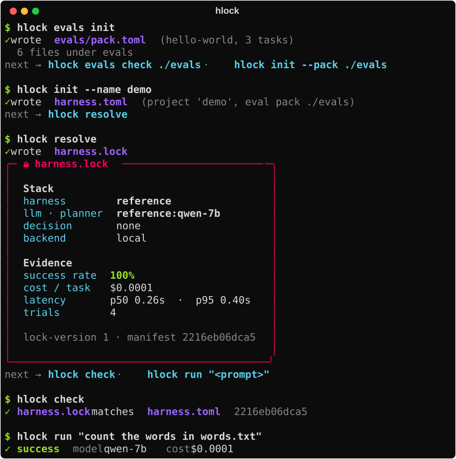

<p align="center">
  
</p>

# hlock { style="text-align: center" }

<p class="hl-tagline">Make your agent harness pinnable, portable, and tunable.</p>

`hlock` tunes your agent stack against your own tasks, then pins the winner in a
`harness.lock`: a pinned, hashed, version-controlled description of the agent that
works for your domain, plus the evidence for choosing it. Commit the lock, and the
same setup comes back on any machine, in CI, or on a cluster.
{ .hl-lead }

<div class="hl-actions" markdown>

[Get started :lucide-arrow-right:](getting-started/quickstart.md){ .md-button .hl-btn .hl-btn--primary }
[:fontawesome-brands-github: GitHub](https://github.com/unionai-oss/hlock){ .md-button .hl-btn .hl-btn--ghost }

</div>

<div class="hl-install" markdown>

=== "pip"

    ```bash
    pip install hlock
    ```

=== "uv"

    ```bash
    uv add hlock            # add to a project
    uv tool install hlock   # or install the CLI globally
    ```

=== "uvx (no install)"

    ```bash
    uvx hlock --help
    ```

=== "pipx"

    ```bash
    pipx install hlock
    ```

</div>

<figure markdown="span">
  { width="620" }
</figure>

## A package manager for agent stacks

If you've used `uv`, `cargo`, or `npm`, you already know the shape of `hlock`:

| You know this from package managers | In `hlock` |
|---|---|
| `pyproject.toml` | **`harness.toml`**, the [manifest](reference/manifest.md): what the resolver may try, and what "best" means |
| dependency resolver | **the resolver**: search over LLMs × decision models × harnesses × policies |
| `uv.lock` / `Cargo.lock` | **`harness.lock`**, the [lockfile](reference/lockfile.md): what was chosen, pinned and hashed, plus the evidence |
| CI `--locked` check | **[`hlock check`](guides/ci.md)**: fail when the manifest drifts from the lock |

<div class="grid cards" markdown>

-   :lucide-flask-conical:{ .lg .middle } **Measured on your tasks**

    ---

    Every candidate stack runs against your [eval packs](guides/eval-packs.md), and the
    lock records success rate, cost, and latency for the one that won.

-   :lucide-lock:{ .lg .middle } **Pinned and enforceable**

    ---

    Models, harness, decision model, and policies are pinned and hashed.
    `hlock check` fails CI when the manifest drifts, and `hlock run` runs exactly what's pinned.

-   :lucide-laptop:{ .lg .middle } **Local first**

    ---

    The built-in reference provider and harness are deterministic and offline. The
    whole loop runs on a laptop with no accounts and no API keys.

-   :lucide-cloud:{ .lg .middle } **Scales when it matters**

    ---

    The same pipeline runs on a [`devbox`](guides/backends.md) with real LLMs, or on a
    Flyte/Union cluster with GPUs, caching, and lineage.

</div>

## Where to next

- **New here?** Start with [Installation](getting-started/installation.md) and the
  [Quickstart](getting-started/quickstart.md).
- **Want the mental model?** Read [How it works](concepts/index.md).
- **Looking something up?** See the [CLI](reference/cli.md),
  [Python API](reference/python-api.md), or [`harness.toml`](reference/manifest.md) reference.
